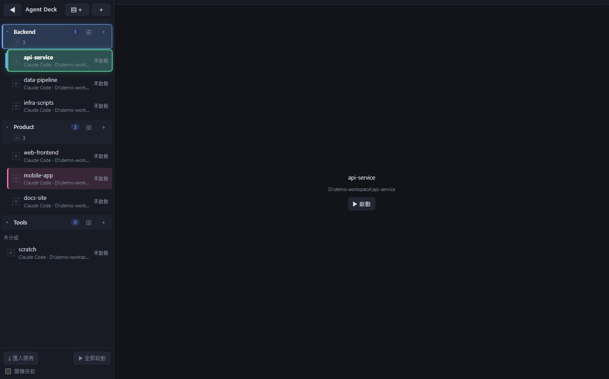
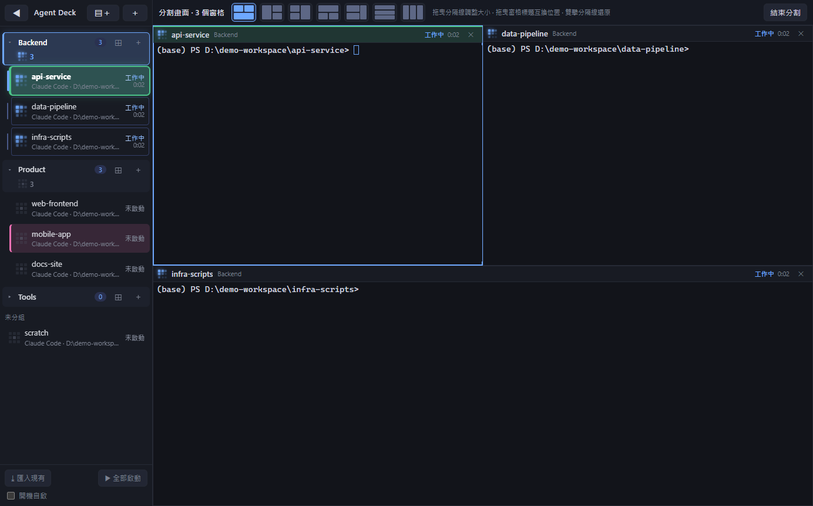
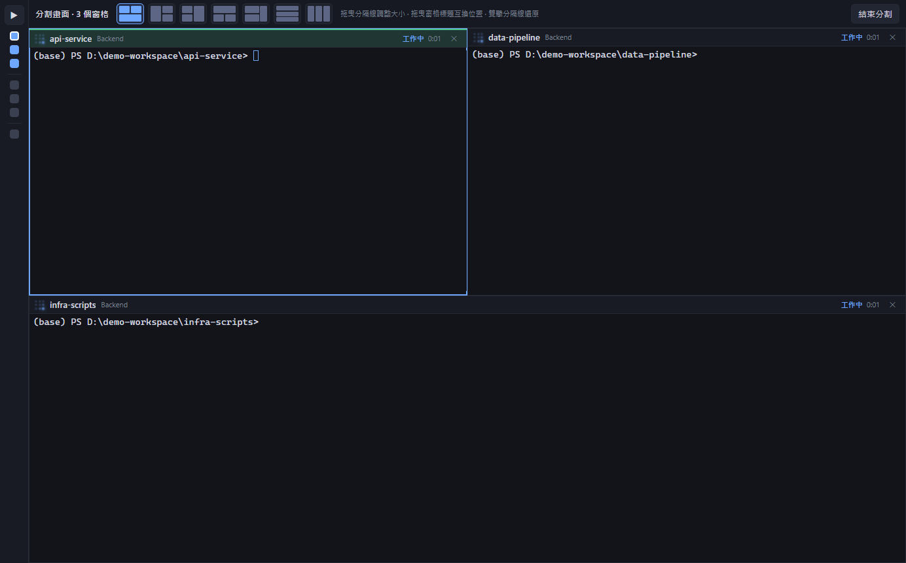

# Agent Deck

**English** | [繁體中文](README.zh-TW.md)

**One window for all your AI coding agents.**

If you work on many projects at once, each running Claude Code, Codex, OpenCode or a similar tool, you have probably run into this:

- After a reboot, you have to open each folder and resume each conversation one by one.
- With dozens of agents running, some have finished and are waiting for you, some are stuck, and you don't notice.

Agent Deck solves this. It is a Windows desktop app that opens each project as a **card**. Cards are listed on the left and the terminal is on the right. Close it and open it again, and every card goes back to its folder and resumes its last conversation.

> The app's interface is in Traditional Chinese. This README gives the on-screen labels in quotes, for example "匯入現有" (Import existing).



## What it does

- **One card = one project = one agent conversation**, resumed automatically after a reboot.
- **Status lights**: a blue wave means working, a still green light means done and waiting for you, a yellow cross means it needs your decision, a red X means an error. When a card in the background needs you, its outline lights up.
- **Groups**: put related cards in a project group and collapse it. A collapsed group still shows whether any card inside needs you.
- **Split view**: watch several agents at once. Click `⊞` on a project header to tile that project's cards side by side.



- **Collapsible sidebar**: hide the card list when you don't need it, leaving one colored dot per card.



## Getting started

1. Download `AgentDeck-Setup-<version>.exe` from [Releases](https://github.com/harry123180/agent-deck/releases) and double-click it to install. It creates desktop and Start menu shortcuts.
   The installer is not code-signed, so Windows may show "Windows protected your PC". Click **More info → Run anyway**.
2. Click **＋** to add a card: pick a folder and an agent (Claude Code, Codex, OpenCode…), then save. The card opens and runs the agent's command.
   No folder yet? Type a new path, or click "新資料夾…" (New folder), pick where it goes and type its name. The folder is created when you save.
3. Want your earlier work back? Click "⤓ 匯入現有" (Import existing). It finds the terminals you have running and your recent Claude conversations; tick the ones you want and add them in one go.

## Basic controls

| To | Do this |
|---|---|
| Add a card | `＋` or Ctrl+T |
| Switch cards | Click a card on the left, or Alt+1–9 |
| Rename | Double-click the card, or F2 |
| Change color | Right-click the card → color |
| Create a project group | `▤＋` at the top of the sidebar |
| Split view | `⊞` on a project header; Ctrl+click a card to add it to or remove it from the split |
| Collapse the sidebar | ◀ or Ctrl+B |
| Zoom the font | Ctrl+wheel, Ctrl+0 to reset |
| Close a card | Ctrl+W (the folder is not deleted) |

## Supported agents

Claude Code, Codex, OpenCode, Gemini CLI, agy, and any tool that runs in a terminal (choose "自訂" (Custom) and enter its command).

## 🧭 Central agent: agents talking to each other, across platforms

A **🧭 中控** (Central) card is pinned to the top of the sidebar. Click it to start a Claude Code session as the central agent. It can see what every card is doing and send a message to the agent in any card, whether that card runs Claude Code, Codex or OpenCode. Agents in cards can reply to the central agent or message each other.

Tools the central agent gets (agentdeck MCP):

| Tool | What it does |
|---|---|
| `list_agents` | List every card: name, platform, project, current status |
| `read_agent` | Read a card's latest screen |
| `send_to_agent` | Send a message to a card (by default it waits until the card is waiting for input, so it never interrupts work in progress) |
| `wait_for_agent` | Wait until a card finishes and return its screen |
| `message_status` | Check whether a message was delivered |

You can simply tell the central agent: "check on everyone", "ask backend to report back when its tests finish", "have docs update the documentation to match backend's API".

The central agent can also reach Claude Code sessions you started **outside Agent Deck** (`list_agents` marks them "outside Agent Deck").

**How messages are delivered**

| Target | Channel |
|---|---|
| Claude Code (in a card or an outside session) | **Claude Code's native cross-session inbox** (see below); Claude itself decides whether to accept the message or hold it for your approval |
| Codex, OpenCode, agy and others | When the card is waiting for input, the message is pasted into its terminal and submitted |

**How each platform gets the agentdeck tools** (Agent Deck does this automatically and never edits your own config files):

| Platform | How | Tested |
|---|---|---|
| Claude Code | `--mcp-config` is added to the start command | Send, receive, two-way replies ✔ (native inbox; in the normal permission mode it asks you before using the tools) |
| Codex | `-c mcp_servers.agentdeck.*` is added to the start command (through a `.cmd` launcher, which avoids PowerShell 5.1 quoting problems) | Send, receive ✔ |
| OpenCode | The card's terminal gets `OPENCODE_CONFIG_CONTENT`, merged with your own MCP settings | Send, receive ✔ |
| agy | Global settings only, so run this once yourself: `agy mcp add agentdeck "%APPDATA%\agent-deck\central\agentdeck-mcp.cmd"` (to remove: `agy mcp remove agentdeck`) | Send, receive, two-way replies ✔ |

**Claude Code's native inbox (reverse-engineered and ported)**

This is how Claude Code's cross-session messaging works (reverse-engineered from the CLI, then confirmed in both directions against the real Claude Code client):

| Part | Details |
|---|---|
| Registration | Each session writes `~/.claude/sessions/<pid>.json`: name, folder, status, `procStart` (the process's real start time), `peerFeatures`, inbox address |
| Key | `peerToken` in `~/.claude/sessions/<pid>.<SHA-256 of the lowercase inbox path>.key` |
| Inbox | A local named pipe (`\\.\pipe\LOCAL\cc-msg-…`), one JSON object per line; the first line must authenticate |
| Messages | `type:"user"` with `msg_id`, `priority` and the sender's inbox `from`; the text is wrapped in `<cross-session-message from=… from-name=…>` |
| Control | `notify_when_idle` (tell me when you're idle), `peer_idle_notice` (idle notice), `peer_message_status` (delivery receipt: held / delivered / denied …) |

The full spec, including tested error and edge-case behavior, is in [docs/claude-cross-session-protocol.md](docs/claude-cross-session-protocol.md) (Traditional Chinese).

Agent Deck is an **honest peer** on this network (`src/main/ccmsg.js`, `src/main/ccpeer.js`):
- **Sending**: messages go to the inbox of a Claude card or an outside Claude session. The process tree tells which session belongs to which card.
- **Receiving**: Agent Deck registers under the name `agent-deck`, with its own PID and real start time. It removes the registration on exit, and cleans up registrations left by a forced shutdown on the next start. Any Claude session can send to `agent-deck` with the built-in `SendMessage`; Agent Deck forwards it to the card that last wrote to that session, or to the central agent otherwise.
- **Receipts**: the delivery status Claude sends back is recorded on the message, so `message_status` shows the real state, such as "held for your approval".

Claude Code protects itself against incoming messages, and Agent Deck follows its rules exactly: **it never fakes its identity or claims a permission mode**.
- A session in a normal permission mode: the message goes straight into its input queue.
- A session in "bypass permissions" mode: the message is **held** and a review box appears (the default choice is Deny), so you decide whether it goes through. The card's light shows "needs decision". To have such sessions accept messages directly, set `crossSessionInbound` to `accept` in your Claude Code settings. That is your choice; Agent Deck never changes it for you.
- If a Claude card's inbox can't be found, the message is reported as failed. Agent Deck does **not** fall back to pasting, because that would get around the protection above. If you do want pasting, set `settings.claudeLane` to `"paste"` in the workspace settings.

**Safety**
- Messages stay on this machine (127.0.0.1, with a new random token on every start).
- Only the central card has the tools pre-approved. Other cards ask you, under that agent's own permission settings, before sending.
- Pasted messages only go to cards waiting for input, never into a screen that is asking you something (a permission prompt, "trust this folder", Claude's review box and so on).
- Every message names its sender, and one thread is limited to 4 round trips so agents can't message each other forever.
- A message you receive was written by another agent. Treat it like any other outside input.

## Requirements

Tested only on **Windows 10/11 (x64)**. macOS is not supported yet.

Native messaging between the central agent and Claude Code uses an unofficial, reverse-engineered protocol (see [docs/claude-cross-session-protocol.md](docs/claude-cross-session-protocol.md)) and may break when Claude Code changes.

## For developers

To run from source (needs [Node.js](https://nodejs.org/)): `npm install`, then `npm start` (or double-click `start.bat`).
To build the installer yourself: `npm run dist`. The output goes to `dist/`.

```
src/main/        main process (terminals, saving, session scanning)
src/renderer/    user interface
src/bus/         agentdeck MCP server (messaging tools for the central agent and cards)
test/            unit tests: node test/<name>.test.js
scripts/         development scripts (icon generation)
```

## License

[PolyForm Noncommercial 1.0.0](./LICENSE): **free to use, study, modify and share, but not for commercial use.** For a commercial license, open an issue to contact the author.
